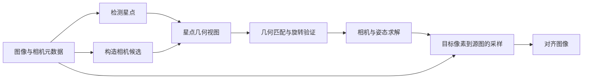

# Norma 组件工作原理

Norma 组件用于执行星空图像的配准。Norma 将星空图像之间的配准拆成两件事：先用星点求出相机模型与相对姿态，再用这些几何信息重采样图像。组件支持双图对齐、同相机序列 Bundle Adjustment（BA）和窗口几何，主要入口由 [norma/\_\_init__.py](../hoshicore/component/norma/__init__.py) 导出。

本文按数据如何变化来解释整个组件。参数默认值、异常条件和完整签名以各节链接的实现为准。

## 1. 整体计算链路



图像像素主要在检测和最终重采样时使用。匹配与求解处理的是紧凑观测：星点位置、单位射线、配对索引和相机参数。这个分工让同一份星点观测能用于不同焦距候选、单图配准和序列联合求解。

关键数据对象对应以下阶段：

| 对象 | 保存什么 | 用于什么 |
| --- | --- | --- |
| `DetectedStars` | 像素位置、加权用的体积/响应量、可选强度 | 描述一张图像上的星点观测 |
| `StarDetectionCache` | 图像或灰度，以及各检测流程的缓存 | 避免参考图或同一阶段重复检测 |
| `GeometryView` | 一组星点、相机和懒计算几何 | 将像素观测转成可匹配的射线与描述符 |
| `AlignmentResult` | 参考到源图的旋转、两侧相机和实际求解策略 | 描述双图几何关系 |
| `BAAlignmentPlan` | 共享相机、各帧姿态、状态与诊断 | 将序列几何交给后续重映射或窗口处理 |

观测与缓存定义见 [detection.py](../hoshicore/component/norma/detection.py) 和 [geometry_view.py](../hoshicore/component/norma/geometry_view.py)，双图与序列结果定义见 [alignment.py](../hoshicore/component/norma/alignment.py) 和 [bundle.py](../hoshicore/component/norma/bundle.py)。

## 2. 几何基础：从像素到相机射线

### 2.1 相机模型解决什么问题

同一颗星在两幅图像中的像素位移受焦距、畸变和相机姿态共同影响。Norma 先通过相机模型将像素位置反投影为单位方向向量，再在三维方向空间中比较星点。这样，透视和鱼眼图像可以使用统一的旋转关系。

`Intrinsics` 保存物理焦距、传感器尺寸、图像尺寸和光心。它们构造像素单位的内参矩阵：

```text
fx = focal_mm * image_width / sensor_width_mm
fy = focal_mm * image_height / sensor_height_mm
K  = [[fx,  0, cx],
      [ 0, fy, cy],
      [ 0,  0,  1]]
```

模型的两个基本操作为：

- `unproject(pixel)`：去除对应模型的畸变，将像素转换为单位射线。
- `project(ray)`：将相机坐标系中的方向投影到像素平面，应用对应的畸变。

透视模型使用径向与切向畸变；鱼眼模型使用随离轴角变化的 Kannala–Brandt 多项式，零系数对应等距投影。不同模型共享上述接口，具体公式由 [projection.py](../hoshicore/component/norma/projection.py) 实现，相机与畸变类型由 [types.py](../hoshicore/component/norma/types.py) 定义。

### 2.2 姿态与映射方向

双图中的 `R_ref_to_src` 将参考相机坐标系的射线旋转到源相机坐标系：

```text
ray_src ≈ R_ref_to_src @ ray_ref
```

Norma 的星点配准以旋转模型解释远处星空的相对运动，不在这套求解中引入平移或场景深度。近处地景通常需要独立区域处理。

`BaseCameraModel` 描述投影几何，相对旋转由对齐结果保存。若调用方已知绝对指向，`Pointing`、`View` 与 [sky_model.py](../hoshicore/component/norma/sky_model.py) 还提供 AltAz、RA/Dec、恒星时和视场旋转的辅助表达与转换；星点配准主流程从图像间观测求相对姿态，不依赖输入绝对天球坐标。

## 3. 星点检测：从图像提取观测

### 3.1 检测流程

检测把背景、噪声和星点光斑转换为候选，再按面积、响应与形状筛选。输出的位置用于几何求解，体积/响应量用于描述符或候选加权。

小波流程是主要使用的机制，通过多尺度响应分离背景与亮点供初始几何匹配使用。实现边界见 [detection.py](../hoshicore/component/norma/detection.py) 与 [custom-op detection.py](../hoshicore/_custom_op/ops/detection.py)。

### 3.2 为什么需要恢复与缓存

光斑形状变化可能使严格筛选排除仍有几何价值的候选。小波恢复根据其他筛选已通过的候选中，有多少仅因形状被拒绝，决定是否采用放宽配置。序列调用可以探测前几帧并以多数投票锁定整组配置，避免每帧独立改变筛选标准。统计和配置选择由 [wavelet_recovery.py](../hoshicore/component/norma/wavelet_recovery.py) 提供。

`StarDetectionCache` 缓存灰度及检测结果，参考图可跨多张源图复用。`GeometryView` 则只关联一组观测与一个相机：它按需反投影单位向量、生成描述符。焦距候选变化时，可以复用像素星点并创建新的几何视图，重新计算依赖相机的量，而无需重新检测图像。

## 4. 初始匹配：先建立星点对应，再验证旋转

### 4.1 两类几何特征

Norma 提供两种初始匹配策略：

| 策略 | 如何描述局部几何 | 如何形成对应 |
| --- | --- | --- |
| 角度直方图 | 从邻近射线的相对方位、角距和观测权重生成归一化描述符 | 按余弦距离寻找互相最近邻，并筛选或补充空间覆盖 |
| Asterism | 从中心星点与邻居形成球面三角形，记录弦长比和边长对数尺度 | 对兼容 token 寻找互相最近邻，再由 token 对锚点投票 |

这些描述对共同旋转保持不变或稳定，因此可以先建立候选对应，再估计旋转。焦距和畸变错误会改变像素反投影后的局部几何，这也是相机候选搜索需要重新匹配的原因。

策略细节由 [matching.py](../hoshicore/component/norma/matching.py) 实现，高层入口 `match_star_pairs()` 与 `match_star_pairs_asterism()` 位于 [alignment.py](../hoshicore/component/norma/alignment.py)。

### 4.2 旋转验证与空间覆盖

候选对应可能包含误配。旋转 RANSAC 从少量配对射线估计旋转，用角残差判断哪些配对一致，再用内点重新估计旋转。求解中的 SVD/Kabsch 步骤寻找两组方向之间的最佳旋转，并约束结果属于正旋转。

匹配质量还要考虑星点在图像上的分布。集中在中心的小片区域可能足以确定旋转，却不能有效约束边缘畸变和光心。覆盖度检查与径向/扇区统计用于评估这种差异；直方图匹配可在质量上限内补回欠覆盖区域的候选。

验证后的 `MatchResult` 包含配对索引、两侧像素位置和初始旋转。后续相机优化消费这些一致的观测，不能只凭候选数量决定图对是否可用。旋转估计、残差门控与覆盖度修复见 [matching.py](../hoshicore/component/norma/matching.py)。

## 5. 双图求解：相机候选与非线性优化

### 5.1 初始化与焦距搜索

相机初值可来自 EXIF 像素密度、35mm 等效焦距、显式参数或 fallback。EXIF 的两个焦距来源会交叉检查；算子层的 auto/manual/separate 模式决定哪些元数据与手动字段参与构建。换算与诊断见 [intrinsics_from_exif.py](../hoshicore/component/norma/intrinsics_from_exif.py)，候选与策略构建见 [frame_align.py](../hoshicore/component/norma/frame_align.py)。

当初始焦距不够可靠，bootstrap 在若干焦距尺度上构造相机候选。每个候选先反投影、匹配和验证旋转，评分结合残差、覆盖、外圈支持与尺度偏移；选中的候选才进入联合优化。同相机匹配共用尺度，独立相机可搜索两侧尺度组合。

这一步首先解决“哪种几何下能够建立可靠对应”，随后非线性优化进一步求“这些对应最支持什么相机与姿态”。

### 5.2 联合求解与自由度控制

对于配对像素 `p_ref[j]`、`p_src[j]`，默认数据残差来自两侧单位射线的叉积：

```text
u_ref[j] = ref_camera.unproject(p_ref[j])
u_src[j] = src_camera.unproject(p_src[j])
e[j]     = cross(R_ref_to_src @ u_ref[j], u_src[j])
```

小角误差下，叉积模长近似两条射线的夹角。优化同时更新旋转和策略允许的焦距、畸变、光心；同相机共用参数块，独立相机分别拥有参数块。相机更新会改变反投影射线，因此残差必须在每次迭代重新计算。

**焦距尺度补偿**用于保持数据目标的近似尺度一致。局部小角度下，相同像素误差对应的角误差约随 `1/f` 缩小；焦距变化因此可能仅通过缩小角残差降低目标值。双图求解从首轮起对 `cross / angular` 数据残差应用：

```text
F = (fx_ref + fy_ref + fx_src + fy_src) / 4
s = F_current / F_initial
r_solver = s * r_data
```

共享焦距偏移时，`s = 1 + focal_delta`；独立相机使用两侧平均像素焦距之比。补偿是近似尺度校正，不能当作精确的逐点像素重投影误差或焦距先验。`pixel` 目标与正则项保持原单位，`raw_angle` 诊断保留原始角度。求解器对完整补偿残差进行数值差分，包含尺度变化的导数；鲁棒损失尺度在求解开始时估计并固定。实现见 [optimization.py](../hoshicore/component/norma/optimization.py) 的 `_compute_flexible_residual_components()`。

`CameraOptimizationPolicy` 控制释放哪些参数。当前求解器使用带参数边界的 SciPy `least_squares(method="trf")`，默认 Huber 损失，对残差向量各分量施加鲁棒损失。统一的 `reg_weight` 可追加相对初值的惩罚残差；它提供先验接口，默认配置中并未为所有相机项加入弱先验。残差、参数布局、边界和损失实现见 [optimization.py](../hoshicore/component/norma/optimization.py)。

不同参数之间可能互相补偿。尤其在小旋转基线下，光心、畸变、焦距与姿态可能难以区分。`optimize_alignment()` 因而检查收敛、触边和相机项可观测性；请求策略不安全时，尝试只优化焦距或只优化旋转，并通过残差门控决定是否保留图对。实际使用的策略写入 `AlignmentResult.camera_policy`。降级与接受规则见 [alignment.py](../hoshicore/component/norma/alignment.py)。

### 5.3 可选的 guided refinement

第一次求解后，已有模型能够预测参考星点在源图中的位置，也能反向预测源星点在参考图中的位置。guided rematch 利用这些预测，在限定半径内寻找双向一致的邻居，而不再从无方向信息的局部特征开始。

小波 bootstrap 可以另取 median 星点进行这一阶段，获得不同观测集合上的新对应。随后重新优化，并在同一组 guided 点上比较更新前后像素残差 P90；匹配不足、失败或无改善时保留第一阶段结果。默认是否执行由调用层决定。

分阶段编排见 [frame_align.py](../hoshicore/component/norma/frame_align.py)，预测与质量门控见 [alignment.py](../hoshicore/component/norma/alignment.py)，半径限制的双向点匹配见 [matching.py](../hoshicore/component/norma/matching.py)。

## 6. 重映射：把几何结果应用到图像

图像变换采用反向采样：遍历目标图的像素，算出它应从源图的哪个位置取值。对齐到参考图时，目标相机是参考相机：

```text
目标像素
  → ref_camera.unproject()
  → R_ref_to_src 旋转
  → src_camera.project()
  → 在源图中插值采样
```

反向采样让每个输出像素都对应一次源图查询。像素是否落在源图有效区域、是否存在覆盖，仍需由变换与后续组合处理。

在零畸变透视条件下，上述映射可写成单应矩阵：

```text
H_ref_to_src = K_src @ R_ref_to_src @ inv(K_ref)
```

homography 路径用其逆矩阵将源图送入 `warpPerspective`。相机模型路径则直接使用投影与反投影，可表达鱼眼与混合投影。两条图像入口见 [align_frame_homography() / align_frame_camera_model()](../hoshicore/component/norma/frame_align.py)。

`project_image_from_camera()` 在支持的投影、插值和 ROI 条件下使用 fused remap，将坐标计算与采样合并。通用路径则建立坐标表后调用 OpenCV remap；其中 `map_scale` 控制坐标网格分辨率，fused 路径不使用该缩放。几何与采样接口见 [types.py](../hoshicore/component/norma/types.py)，后端包装见 [custom-op remap.py](../hoshicore/_custom_op/ops/remap.py)。

## 7. 序列 BA：在匹配图上求共享相机与全部姿态

### 7.1 从图对到观测图

序列中每帧是一个图节点，成功匹配的图对是边。边保存两侧像素对应与初始相对旋转。dense 拓扑按指定偏移建立边，multiscale 拓扑用多尺度稀疏连接覆盖不同时间跨度。

先沿匹配边传播初始姿态，再联合优化共享相机与各帧姿态。参考帧固定为单位旋转，定义整个结果的相对坐标系，消除所有姿态共同旋转的自由度。

设 `R_i`、`R_j` 都把参考坐标系旋转到各自帧，则边 i→j 的旋转为：

```text
R_i_to_j = R_j @ R_i.T
```

将帧 i 的射线旋转到帧 j 后，应与边上配对的帧 j 射线一致。BA 将所有有效边的残差放在同一个目标中，避免每帧只依据一个局部图对独立决定相机参数。图构建、姿态初始化与共享参数求解见 [bundle.py](../hoshicore/component/norma/bundle.py)。

共享相机联合求解沿用 §5.2 的焦距尺度补偿，从首次拟合到异常边剔除后的重拟合使用同一目标。焦距自由时，`r_solver = (1 + focal_delta) * r_cross`；解析 Jacobian 同时乘以该尺度，并在焦距列追加乘积法则项 `r_cross`。焦距固定时尺度为 1，不追加焦距导数；长序列固定相机的姿态求解也不释放这一自由度。补偿不扩大相机参数边界，实现见 [bundle.py](../hoshicore/component/norma/bundle.py) 的 `_solve_bundle_parameters()`。

### 7.2 连通性、异常边与长序列

只有与参考帧连通的图分量具有参考相对姿态。求解拒绝高残差边后会重新检查连通性，未连接或未通过验证的帧以 excluded 状态进入结果，而不是伪造一个可用旋转。

相机可观测性不足时，序列求解可尝试减少相机自由度。长序列还可先抽样求共享相机与锚点姿态，再固定相机、按锚点分段求其他帧旋转。解析旋转 Jacobian 与稀疏姿态结构减少求解成本；相机列仍使用数值差分。

`BAAlignmentPlan` 保存共享相机、逐帧状态与旋转，以及边和求解模式诊断，不保存完整图像。几何确定后，调用层重新加载原始帧以应用方案。观测必须来自同一投影类型和图像几何，第二次加载必须保持原顺序与尺寸。几何接口见 [bundle.py](../hoshicore/component/norma/bundle.py)，流式集成见 [BundleAdjustmentOp / BundleReferenceRemapOp](../hoshicore/ops/bundle_ops.py)。

## 8. 窗口几何：把全局姿态转成中心帧坐标

窗口输出以当前中心帧为目标坐标，而不是始终使用序列参考帧。已有 BA 姿态后，贡献帧 s 与中心帧 c 的相对旋转直接得到：

```text
R_center_to_source = R_s @ R_c.T
```

因此无需为每个滑动窗口重新检测和求一次全局几何。窗口调度在序列边缘截短邻域，排除 excluded 帧，并依据最少贡献帧数量决定哪些中心能够生成有效窗口。`BundleWindowSpec` 保存中心索引与贡献帧的旋转；实现见 [bundle_window.py](../hoshicore/component/norma/bundle_window.py)。

Norma 在这里提供几何调度。图像重映射后的均值、最大值、中位数或 Sigma Clipping 归约，以及天空/地面区域合成，由 [窗口算子](../hoshicore/ops/bundle_ops.py) 集成。该层用 `WindowFrame` 保留每个输入位置的状态，最后由同一个筛选门同步输出图像、EXIF 和中心索引。

## 9. 核心计算、执行集成与加速边界

| 层次 | 负责的工作 | 实现入口 |
| --- | --- | --- |
| 双图几何 | 接收星点、相机候选，匹配并求解几何 | [frame_align.py](../hoshicore/component/norma/frame_align.py)、[alignment.py](../hoshicore/component/norma/alignment.py) |
| 图像对齐 | 创建检测缓存，调用几何求解并重映射 | [frame_align.py](../hoshicore/component/norma/frame_align.py) |
| 序列几何 | 接收紧凑观测，生成 BA 方案与窗口调度 | [bundle.py](../hoshicore/component/norma/bundle.py)、[bundle_window.py](../hoshicore/component/norma/bundle_window.py) |
| DAG 集成 | 消费队列、管理参考图与配置、同步过滤旁路、重新加载和保存结果 | [alignment_ops.py](../hoshicore/ops/alignment_ops.py)、[bundle_ops.py](../hoshicore/ops/bundle_ops.py)；图像加载与保存由其他算子组合 |
| native 内核 | 执行检测像素工作、特征计算、部分匹配及 fused remap | [alignment.py](../hoshicore/_custom_op/ops/alignment.py)、[detection.py](../hoshicore/_custom_op/ops/detection.py)、[wavelet.py](../hoshicore/_custom_op/ops/wavelet.py)、[remap.py](../hoshicore/_custom_op/ops/remap.py) |


理解调用结果时，要分别判断星点观测是否可靠、匹配是否有空间支持、相机自由度是否可辨识、像素采样是否有覆盖，以及序列旁路是否同步。这些条件由不同阶段验证，共同决定最终对齐结果。
